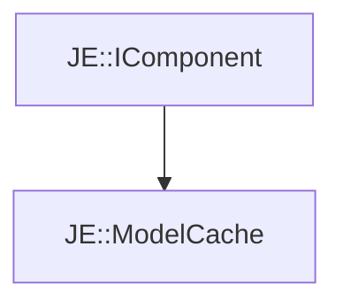

# JE::ModelCache

[Return to `JE`](/docs/je.md)

## C++

- [`ModelCache.hpp`](/src/je/ModelCache.hpp)
- [`ModelCache.cpp`](/src/je/ModelCache.cpp)

## References

- [`JE::IComponent`](/docs/je/IComponent.md)

## Inheritance

## Reverse engineering notes

Full annotations live in the original database (`artifacts/F3.exe.i64`): `JE::ModelCache::ctor_0x585c00`,
`dtor_0x585b10`, the vftable at `0x69b9bc`, and the global `g_model_cache` (was `byte_70C528`).

### Confirmed

- Single instance. `F3::InitializeModelCache` (`0x45e270`, F3 init-table slot 5, after
  `InitializeNetwork` and before `InitializeGameAnimationCache`) does `operator new(0x20)` +
  `ModelCache()`. `sizeof(ModelCache) == 0x20`; the RTTI descriptor's `0x1C` excludes the vftptr.
- The ctor (`0x585c00`) throws `Exception("ModelCache object already exists.")` (`0x585ca1`) when
  `g_model_cache != 0`, then stores `this` (`0x585cce`); the dtor clears it (`0x585b8a`).
- The database previously modelled this object twice: as `ModelCache` (destructor + vftable) and as
  `cls_0x585c00` (constructor, which auto-analysis mislabeled a destructor). They are the same class.
- Only the destructor is overridden. Vftable `0x69b9bc` (6 slots): `[0] 0x585e00` scalar deleting
  destructor, `[1] 0x59c230` = `mov eax,[ecx]; jmp [eax+10h]` (forwards to slot 4), `[2] 0x5b1510` =
  `jmp [eax+14h]` (forwards to slot 5), `[3]..[5] 0x404b70` = `retn`. The cache API is therefore
  non-virtual and reached through `g_model_cache` (60 references from 32 functions: `JE::Entity`,
  `JE::ModelInstance`, `JE::WaterTileModelInstance`, `F3::GameActionOperateContainer`, ...).
- Members: `0x04`/`0x08`/`0x0C` and `0x10`/`0x14`/`0x18` are two MSVC STL trees (flag byte, header
  node, node count). Header nodes come from `0x45c940` (`0x38`-byte nodes) and `0x59ec40`
  (`0x30`-byte nodes); both are engine-wide instantiations (also used by `JE::Map::ctor_0x57b330`,
  `JE::Entity::ctor_0x5513a0`, `JE::GUI::Skin`, `F3::GameAnimationCache::ReadAnimations_0x45d300`,
  ...), not `ModelCache`-specific. Tree elements own heap objects: the dtor destroys and frees the
  pointer at `node+0x28` (`0x567f50`), i.e. the cached models. Keys are `std::string` compared
  case-insensitively (`0x4339b0` lower bound + `_stricmp`); string is the 0x18-byte MSVC layout with a
  16-byte inline buffer.
- `0x1C` is a count read through the singleton by consumers (`JE::ModelInstance::meth_0x563d30` at
  `0x563d36`, `meth_0x563dd0` at `0x563dd6` use it as a loop bound).

### Open questions

- Exact template arguments (key/value types) of the two trees; only the key string of tree A and the
  cached-object pointer at `node+0x28` of tree B are evidenced.
- The ctor's trailing loop (`0x585cf5`) formats decimal keys `"1"`, `"2"`, `"3"`, ... and probes tree A.
  Its purpose and its relationship to `mbr_0x1c` are unresolved; the pseudocode there is unreliable
  because of missing types.
- Who destroys the singleton, and the shutdown ordering relative to `JE::ModelInstance` users.

[Return to `JE`](/docs/je.md)